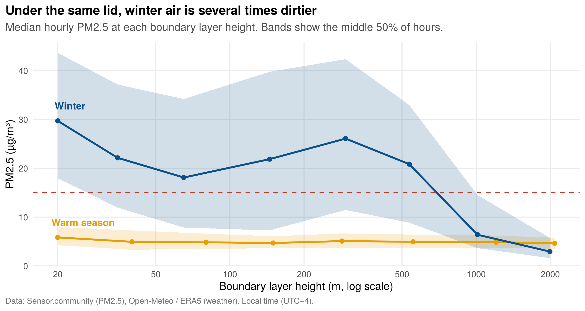
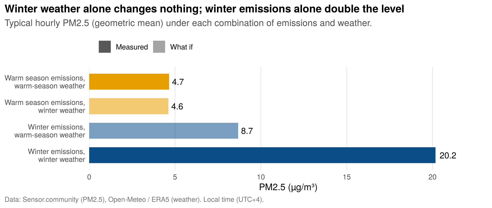

# Winter Air Pollution in Yerevan — is it the weather, or is it us?

Every winter the air in Yerevan turns unhealthy, and the official explanation
is geography: a basin, a temperature inversion, a lid of still air that traps
whatever the city emits. If that is the whole story, there is little anyone can
do about it.

This project tests that explanation against three winters of hourly
measurements from a citizen sensor network, combined with hourly weather.

**The answer: both, but not in the same way. Weather decides *which days* are
bad. People decide that there is anything to trap.**

---

## What we found

| | |
|---|---|
| **69%** of winter days exceed the WHO 24-hour guideline | against 0.0% in the warm season |
| **48%** of the day-to-day variation within winter is explained by weather | so the official explanation is half right |
| **5 µg/m³ vs 27 µg/m³** under the same low lid, warm season vs winter | the other half |
| **×1.9 emissions × ×2.3 weather** | how winter gets to 4.3× the warm season |
| **+16% per day** on still days, **−17%** on windy ones | pollution accumulates over days, it does not just appear |
| **2% of homes, 98% of heating particles** | firewood, from published fuel and emission data |

### The chart the argument rests on

A low boundary layer is a lid over the city. If weather alone created the
pollution, a low lid should mean dirty air in any season. It does not.



In the warm season the line is flat: a low lid over a city that is not emitting
traps nothing. In winter the same lid gives roughly five times more.

### Putting numbers on it

Each season gets its own model of how pollution responds to weather, then the
weather is swapped between them.



Give the warm season winter's weather and nothing happens (4.7 → 4.6 µg/m³).
Give winter the warm season's weather and the level is still 8.7. Weather is an
amplifier; it needs something to amplify.

---

## How the report is built

The whole project is one R Markdown file that knits from a clean session with
no manual steps. Every number in the text is computed by inline R code, so
nothing can drift out of date when a threshold or a dataset changes.

```r
install.packages(c("tidyverse", "lubridate", "patchwork", "broom",
                   "sandwich", "lmtest", "ggrepel", "scales", "rmarkdown"))

rmarkdown::render("report.Rmd")   # or click Knit in RStudio
source("render.R")                # knits to docs/index.html instead
```

All thresholds (minimum readings per hour, minimum hours per day, the WHO
guideline, which months count as winter) are defined once at the top of the
report. Changing one of them updates the text, every chart, and the robustness
table together.

---

## Repository layout

```
├── report.Rmd          the analysis: data preparation, charts, models, conclusions
├── render.R            knits the report to docs/index.html
├── data/
│   ├── yerevan_pm_hourly_sensorcommunity_full.csv     164,176 sensor-hours
│   ├── yerevan_pm_sensors_full.csv                    sensor locations and models
│   ├── yerevan_weather_hourly_openmeteo_2023_2026.csv 28,824 hours of weather
│   ├── armenia_household_gas_monthly_2020.csv         published figures, sourced per row
│   └── yerevan_heating_fuels.csv                      published figures, sourced per row
├── docs/
│   ├── report.html      the knitted report
└── figures/            key charts, exported for this README
```

---

## Data

| Source | What it gives | Period |
|---|---|---|
| [Sensor.community](https://sensor.community/) | Hourly PM2.5 and PM10 from citizen sensors in Yerevan | Jul 2023 – Oct 2026 |
| [Open-Meteo](https://open-meteo.com/) (ERA5 reanalysis) | Hourly temperature, wind, humidity, precipitation, boundary layer height | Jul 2023 – Oct 2026 |
| R2E2, *Analysis of Options for Sustainable Heating in Armenia* (2022) | Household heating fuels in Yerevan (ILCS 2020); monthly household gas use | 2020 |
| German national emission inventory (2025) | PM2.5 emitted per unit of heat, by fuel | 2025 |

Eight sensors are used. One was excluded for being in Gyumri, 100 km away, and
one for being a different sensor model with no winter data that reads three
times its neighbours. Both exclusions are stated in the report.

### What the analysis does

1. **Cleaning** — drop the two sensors above, keep hours with at least 5 raw
   readings, convert UTC to local time before anything about hours or weekdays.
2. **City index** — the median across sensors each hour, so one faulty device
   cannot move the result.
3. **Daily values** — the mean of the hourly index, for days with at least 18
   valid hours (the WHO guideline is a 24-hour average).
4. **Weather model** — a linear model on `log(PM2.5)`, with Newey–West standard
   errors because consecutive days are correlated (0.78 at lag 1).
5. **Season swap** — fit each season's response to weather separately, then
   exchange the weather to separate emissions from dispersion.
6. **Robustness** — every headline number recomputed five ways: without humid
   hours, on the long-running sensors only, and each winter separately.

---

## Honest limits

- Citizen sensors are not reference monitors. The argument rests on
  *comparisons*, where a calibration offset largely cancels, and eight
  independent devices correlate at 0.88–0.99.
- The weather comes from a reanalysis grid cell, not a station.
- We never measured a source. "Heating" is the explanation most consistent with
  the patterns and the published fuel data, not a measurement.
- Three winters is three observations. We do not claim a trend.
---

## Authors

A group project for **DS116 Data Visualization**, American University of
Armenia, autumn 2026.

- Vahan Tonoyan
- Arsen Kocharyan
- Nare Davtyan
